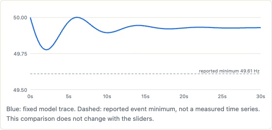

# Why the lights stay on

[](https://github.com/Guinerve/why-the-lights-stay-on/actions/workflows/ci.yml)

An interactive explainer of what happens to grid frequency in the seconds after a big generator trips.

**[Open the live explainer](https://guinerve.github.io/demos/why-the-lights-stay-on/)**


When a large generator trips, the grid suddenly has less supply than demand, and frequency falls. Inertia slows the fall at first. Governors and batteries then add power and stop it. I built this page to show how each of those parts changes the result. You move six sliders and three charts update at once.

The page also compares one fixed model run with a real event: the Kogan Creek trip in Queensland on 9 October 2019. It shows where the model and the evidence disagree, and by how much.

## Quick start

Use Node.js 22 (22.12 or later), Node.js 24, or Node.js 26 or later.

```bash
npm ci
npm run dev
```

Open `http://localhost:5191`. The dev server listens on all network interfaces, so other devices on your network can use `http://<your-ip>:5191`. Port 5191 is fixed. If another program uses it, the server stops with an error.

To build and serve the static site:

```bash
npm run build     # type check, then build to dist/
npm run preview   # serve dist/ on port 5191 (stop the dev server first)
```

The build is a static site with relative asset paths, so it works from a subdirectory. It needs no backend and no API keys.

## The Kogan Creek comparison

On **9 October 2019**, the generating unit at Kogan Creek in Queensland tripped from **748 MW**. AEMO reports that frequency fell to **49.61 Hz**. The South Australia virtual power plant detected the fall and injected power to help recovery.

Source: [AEMO, *Virtual Power Plant Demonstration*, knowledge sharing report #1, section 2.1.1, page 7](https://arena.gov.au/assets/2020/03/aemo-virtual-power-plant-demonstration-knowledge-sharing-report-1.pdf#page=7).

Only the size of the loss comes from the event. I did not fit any response parameter to the reported minimum.

| Quantity | Model input or result | Where it comes from |
| --- | --- | --- |
| Generation lost | 748 MW | Reported by AEMO |
| System load base | 25,000 MW | Assumed, not event data |
| Loss per unit of load | 0.02992 (2.992%) | Calculated from the loss and the assumed base |
| Inertia H | 4 s | Assumed |
| Governor droop / time constant / headroom | 5% / 4 s / 10% | Assumed |
| Load damping | 1 | Assumed |
| Battery power | 0 | Left out, because the source does not give a total event capacity |
| Initial frequency | 50 Hz | Assumed |
| Model minimum | 49.78 Hz at 2.09 s | Calculated over 30 s with a 0.01 s step |
| Reported event minimum | 49.61 Hz | Reported by AEMO, with no claim about timing |
| Model minus reported minimum | +0.17 Hz | Calculated before rounding |

The model understates the frequency fall. Its chart shows the calculated trace and a dashed line at the reported minimum. **The dashed line is one reported value, not a measured time series.** The sliders do not change this comparison.



I kept the mismatch on purpose. The page keeps the evidence apart from the assumptions and shows the error openly. A match on one minimum would not confirm the timing or the cause. The [research note](research/2026-10-13-kogan-creek-comparison.md) has the source quote, the full calculation and the model differences.

## How the model works

The model is the swing equation for one bus. Powers are per unit of system load before the event:

```text
2H/f₀ · dΔf/dt = −loss + governor + battery − D·Δf/f₀
```

- **Governor.** It follows a droop target through a first order lag. A headroom limit caps its output.
- **Battery.** It responds to the frequency it measured one delay earlier. Its output is proportional to that deviation and reaches its power limit at 0.5 Hz.
- **Integration.** Fixed step RK4 integrates frequency and governor state. Battery output stays constant within each step. The delay is rounded to whole steps.

The charts draw three reference lines. 49.85 Hz marks the bottom of the normal band. 49.5 Hz is a reference for a single generation event. 49.0 Hz is an example load shedding threshold. Real requirements and protection settings depend on the region and the event. See the [AEMC frequency operating standard review](https://www.aemc.gov.au/market-reviews-advice/review-frequency-operating-standard-2022).

## Limits

- The model has no transmission network, voltage, separate machines, governor deadbands, secondary frequency control, battery energy limit or protection action.
- Frequency can settle below 50 Hz, because nothing restores it.
- The battery can absorb power if its delayed frequency reading is above 50 Hz.
- Crossing 49.0 Hz changes only the warning text. The model does not shed load or predict customer outages.
- The chart axes expand to fit extreme slider settings.

This is a teaching tool, not an operational tool.

## Tests

```bash
npm test          # 17 tests
npm run build     # TypeScript check and production build
```

The tests check:

- the linear fall in frequency with no governor, damping or battery, against the analytic result;
- the steady state droop balance, with and without load damping;
- the effect of inertia, battery power and battery delay;
- a stable minimum frequency when the time step is halved;
- the battery delay, the power limits and the absence of any load shedding action;
- finite traces at all 64 corners of the six slider ranges;
- the Kogan Creek loss conversion, the mismatch and its independence from the sliders;
- round axis ticks whose labels match their gridlines.

CI runs the tests and the build on every push and pull request. These checks confirm that the code does what it says. **They do not validate the model against the real grid.**

## Code layout

| File | What it holds |
| --- | --- |
| `src/sim.ts` | Model, integration and summary values |
| `src/event.ts` | Reported Kogan Creek values, source URL and assumed inputs |
| `src/chart.ts` | SVG chart drawing and axis ticks |
| `src/main.ts` | Slider bindings and the fixed comparison |
| `index.html` | Explainer text, source citation and limits |

Built with TypeScript, Vite, SVG and Vitest. No chart library.

## Licence

[MIT](LICENSE)
