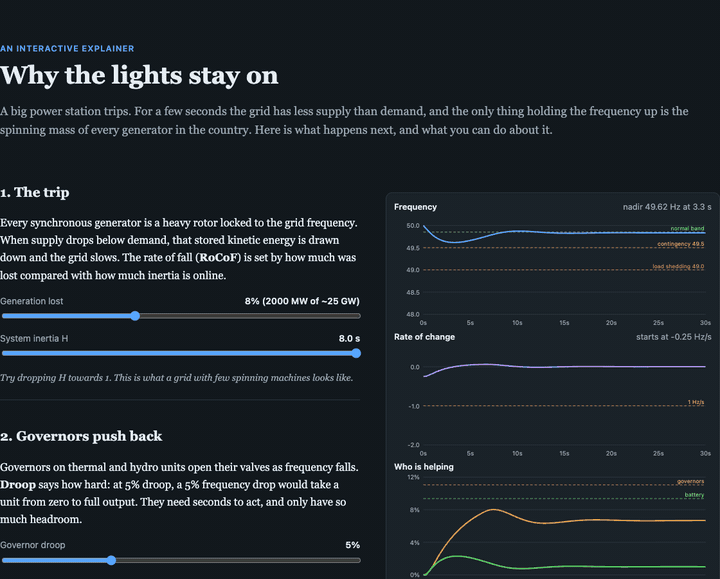
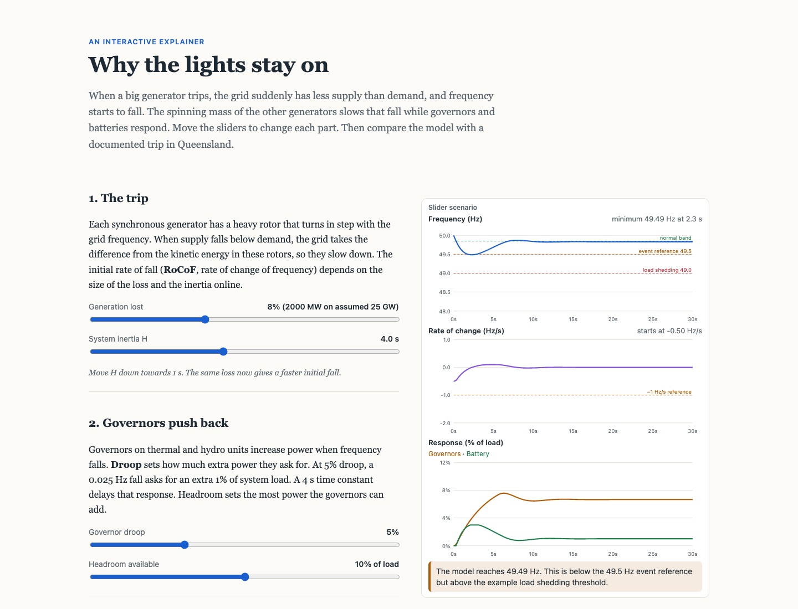

# why-the-lights-stay-on

> An interactive explainer of what happens to grid frequency when a big generator trips.

**Status:** v0.1 core built; layout and charts checked in real Chrome





## The idea

An interactive explainer in the style of Bartosz Ciechanowski or Nicky Case. A big generator trips and frequency falls. How far it falls depends on system inertia, governor droop and how fast batteries respond.

## Stack

TypeScript, Vite, Canvas/SVG charts, Vitest.

Dev server binds to `0.0.0.0` on port **5191** so it's reachable over Tailscale (`vite --host 0.0.0.0 --port 5191 --strictPort`). Deploy to GitHub Pages.

## Build plan (v1)

- [x] Aggregated swing equation: 2H/f₀ · df/dt = Pₘ − Pₑ, with governor droop and a battery fast-frequency-response block
- [x] Fixed-step RK4 integrator
- [x] Sliders: inertia (H), generator size lost, droop, battery response delay and size
- [x] Live charts: frequency and RoCoF, with a line marking where under-frequency load shedding starts
- [ ] (partly done) Scrolling prose that walks the reader through each slider (three sections written; needs an editing pass and a sticky chart layout check on a phone)
- [ ] "Replay" preset reproducing the *shape* of a published AEMO incident report (labelled qualitative)

## Run it

```bash
npm install
npm run dev      # http://0.0.0.0:5191 (Tailscale-reachable, --strictPort)
npm test         # 7 tests
```

## How I know it's right

7 unit tests pass (`src/sim.test.ts`):

- With no droop and no damping the integrator reproduces the analytic linear decline, `df/dt = -ΔP·f₀/(2H)`, to 9 decimals.
- Steady-state deviation matches the droop formula `Δf = -ΔP·f₀ / (1/R + D)` to 3 decimals, with and without load damping.
- More inertia gives a gentler initial RoCoF; a bigger or faster battery raises the nadir.
- Halving the RK4 step changes the nadir by under 0.005 Hz.

Review fixes: the pinned chart panel is capped at 42 % of the viewport (it used to cover the sliders on laptop screens), and the power chart's axis scales with the sliders instead of clipping.

Not yet done: comparison against a published event.

## Limits

**Model constants are plausible, not fitted**: governor time constant 4 s, 10% headroom, load damping 1, battery full output at a 0.5 Hz deviation. Thresholds follow the NEM frequency operating standard (49.85 / 49.5 / 49.0 Hz).

Single-bus aggregate model: no network, no voltage, no protection detail. The replay is qualitative, not a reconstruction.

## Browser check

Checked in real Chrome (headless, driven with puppeteer) on 2026-10-12: the page loads without console errors; the charts update; on wide screens the charts sit in a sticky side column (they used to cover the sliders). On a phone the pinned panel was covering the prose; it is now capped at 32 % of the viewport and shows only the frequency chart, with the other two behind a "More charts" toggle (checked at 390 px wide: no horizontal overflow). `powerflow-playground` and `ember` were also checked at 390 px: no overflow.

## Next (tomorrow)

- Review the phone layout by eye (screenshotted, not reviewed).
- Write the AEMO-incident "Replay" preset (pick a public incident report, label it qualitative).
- Prose pass, hero GIF.

## Stretch

A second chapter on system strength and grid-forming inverters.

## Definition of done

- [x] Hero GIF or screenshot at the top of this README
- [x] Live demo link or one-command run (`npm install && npm run dev`)
- [ ] "How I know it's right" section filled in with real results
- [ ] Tests passing in CI, badge added
- [ ] "Limits" section written
- [ ] Licence chosen, repo description and topics set
- [ ] Pinned on GitHub profile and added to guinerve.github.io
- [ ] Added to `career-radar/data/cv/portfolio.json`
